

# PokéDex+

**A Pokédex for your phone that works offline: every Pokémon, item, berry, trainer and badge,
with themes inspired by the games' own Pokédexes.**

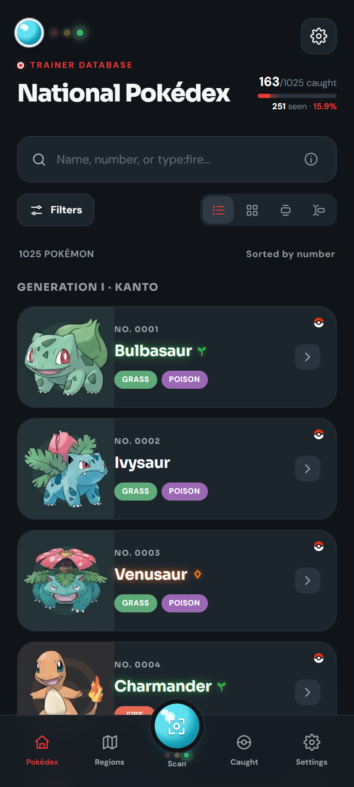&nbsp;
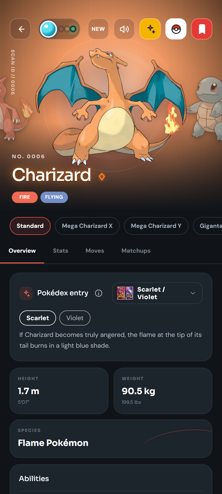&nbsp;
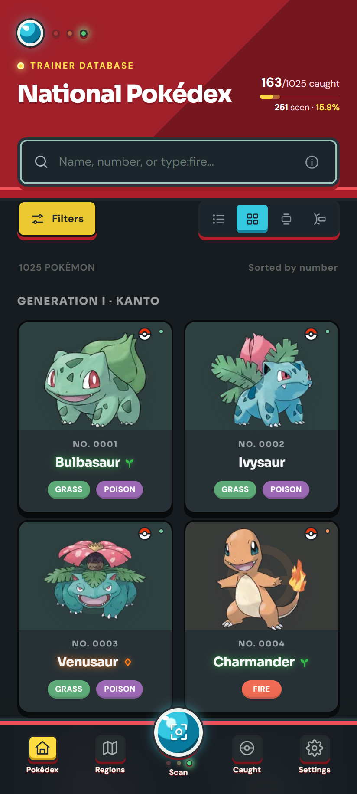

## What it is

PokéDex+ puts all 1,025 Pokémon and their forms in your pocket, with no internet needed: the whole
database comes with the app. Look up stats, moves, matchups and evolutions, track what you've
seen and caught, and browse the items, berries, TMs, regions, trainers and badges of every game.

It's built to be yours: pick a theme, light or dark, how lists are laid out, and what goes in the
bottom bar.

- **Android:** download the APK from [Releases](https://github.com/XZcutable/pokedex/releases/latest).
- **iPhone:** coming later, as a web app you add to your home screen.

## Screenshots

### Pokédex

| List | Grid (light) | Carousel |
|:---:|:---:|:---:|
|  | 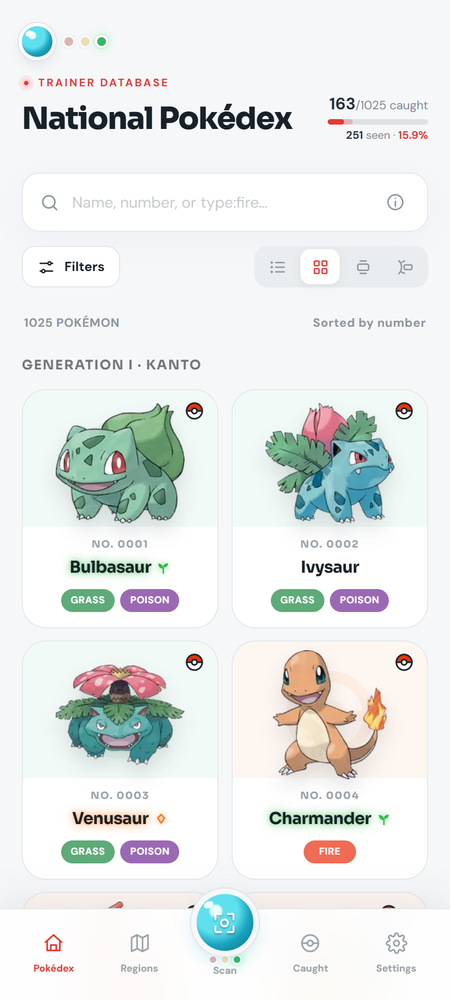 | 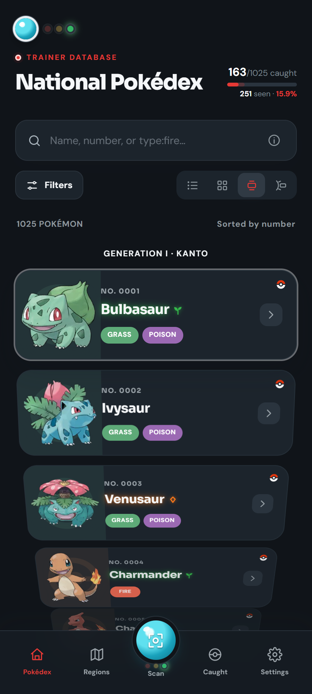 |

**Disc**: turn your phone sideways for a wheel with an info panel beside it.

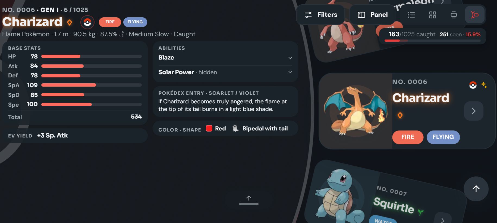

### Profiles and search

| Profile | Stats and calculator | Search language |
|:---:|:---:|:---:|
|  | 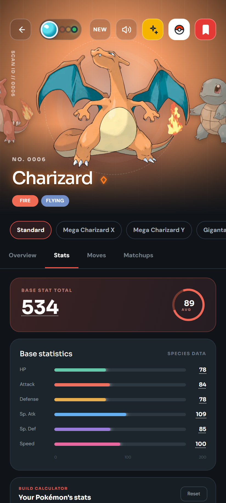 | 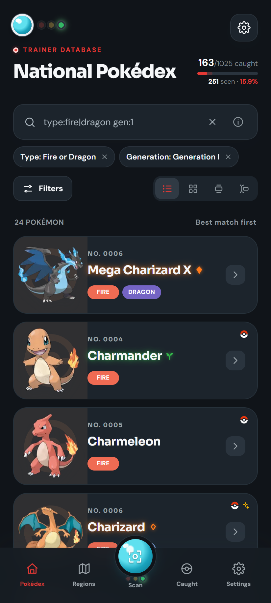 |

| "Who's that Pokémon?" | Regions | Trainers |
|:---:|:---:|:---:|
| 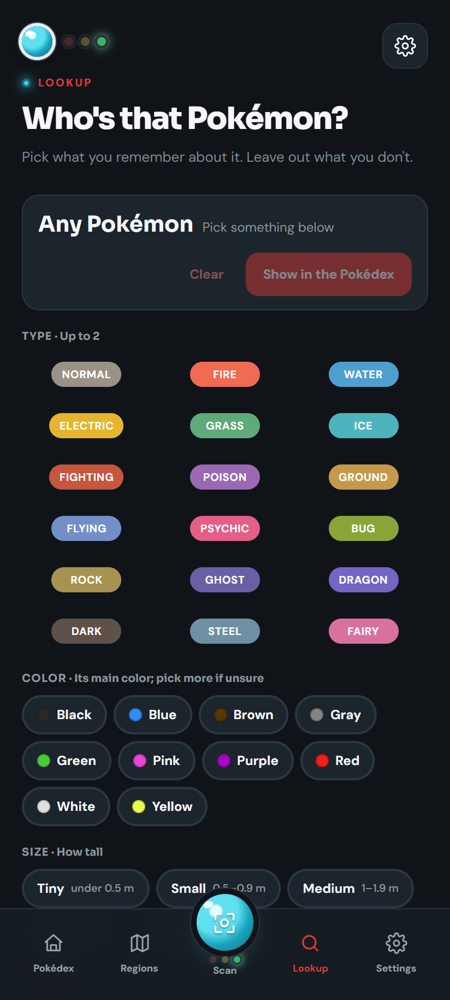 | 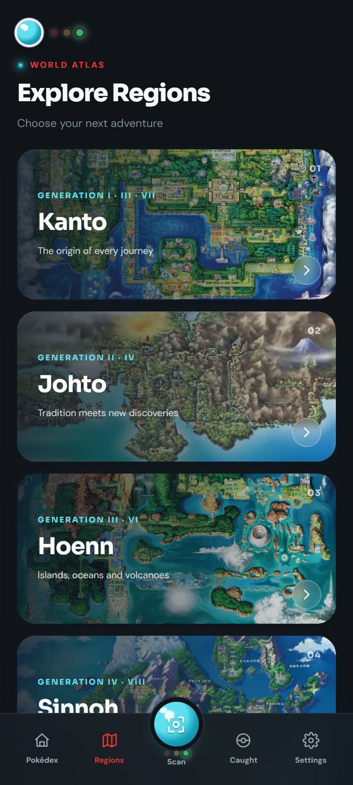 | 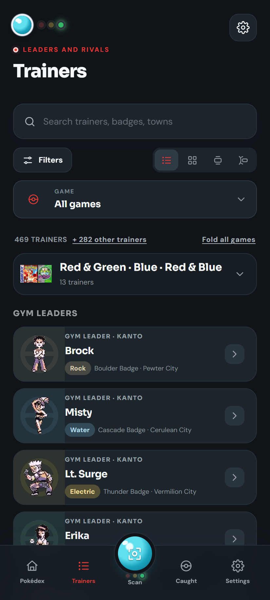 |

### More dexes and tools

| Trainer page | Badges | Itemdex (light) |
|:---:|:---:|:---:|
| 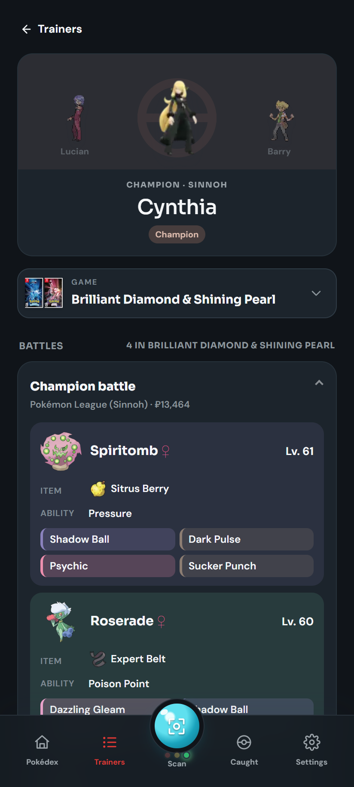 | 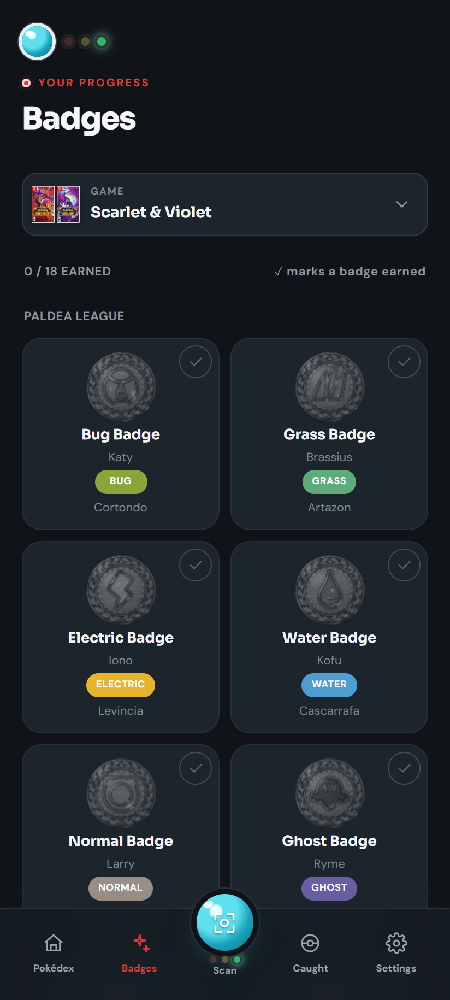 | 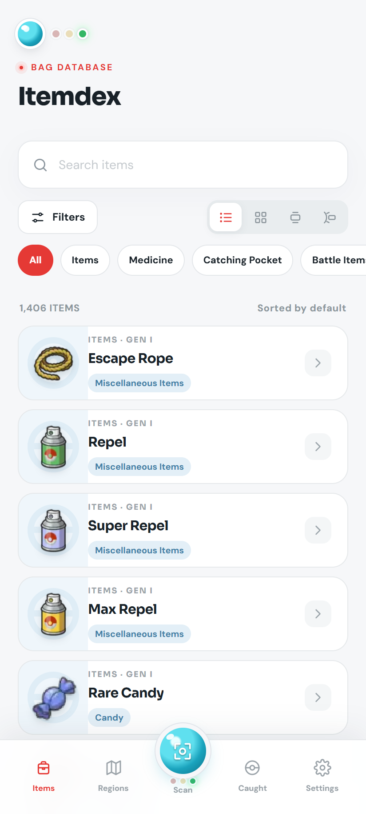 |

| Berrydex | Trainer card | Type trainer |
|:---:|:---:|:---:|
| 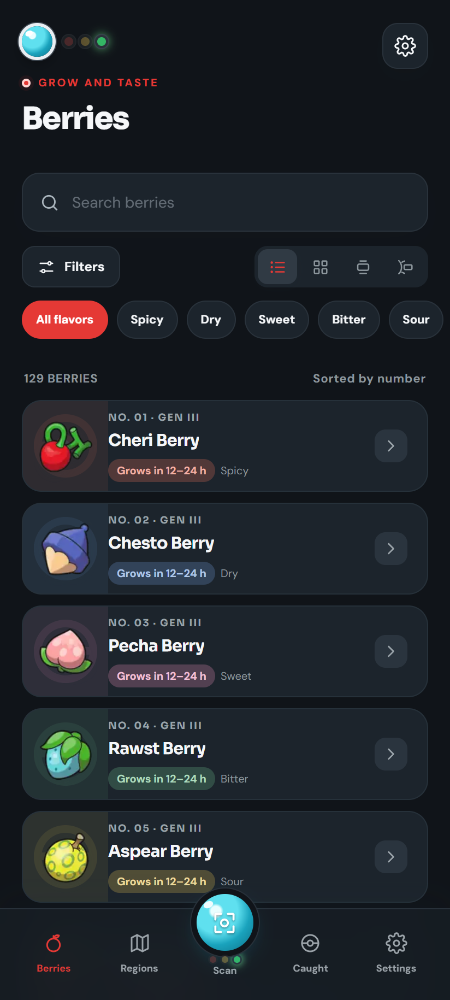 | 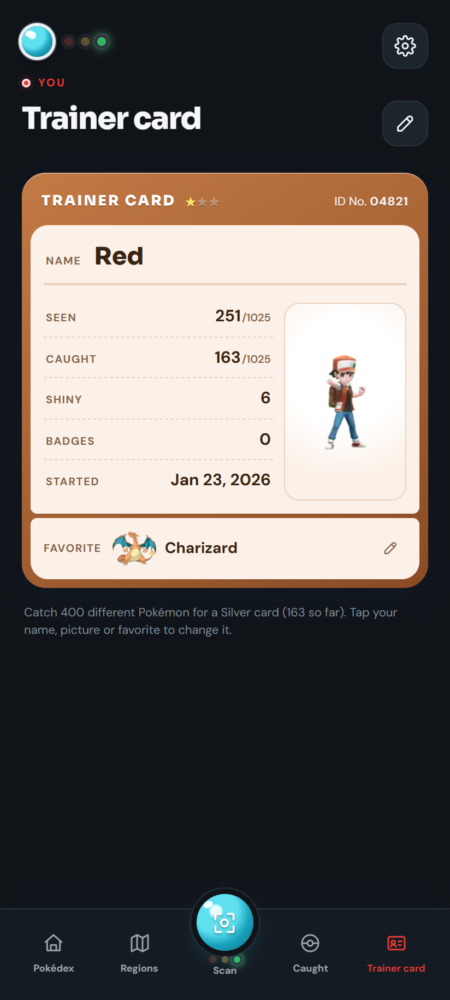 | 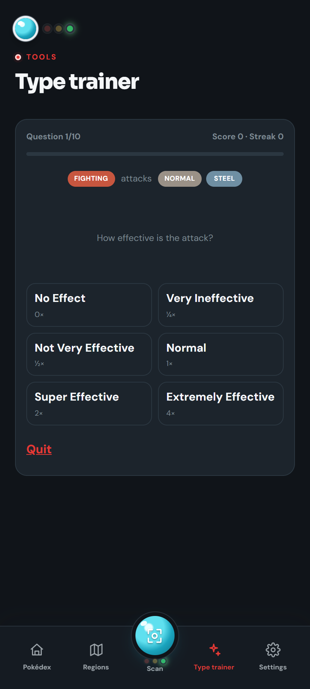 |

### Themes

Four themes, each in light and dark (Settings → Theme and Appearance).

| Modern | Classic | Diamond | Pearl |
|:---:|:---:|:---:|:---:|
| 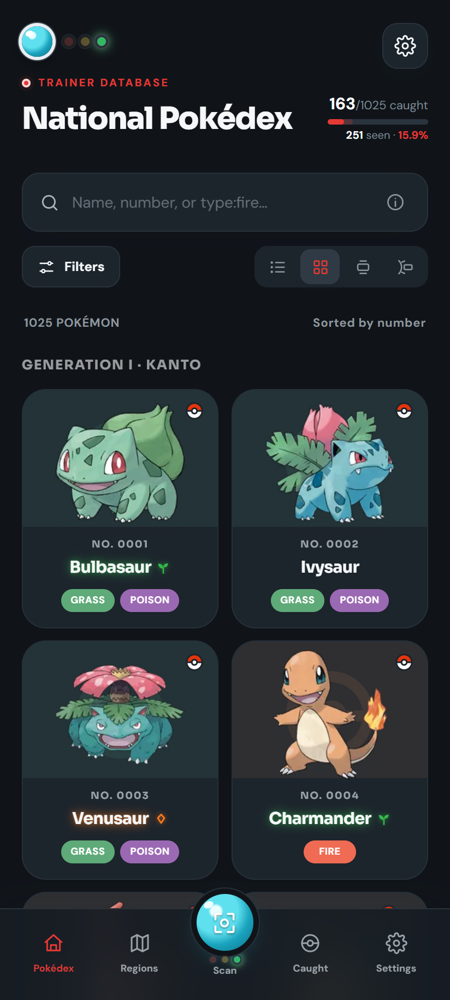 |  | 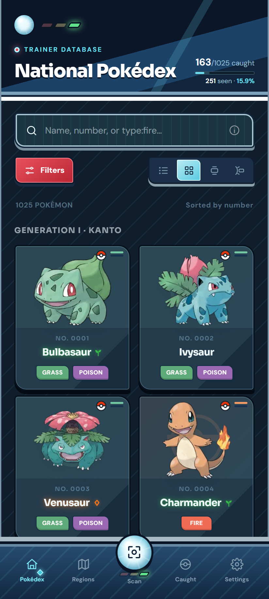 | 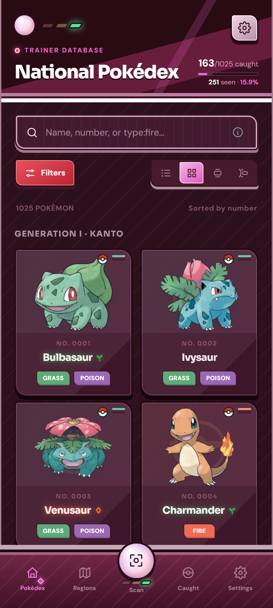 |

| Classic, light | Classic, dark |
|:---:|:---:|
| 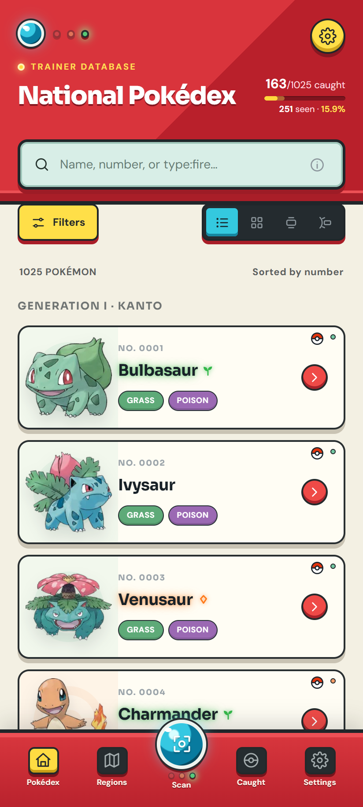 | 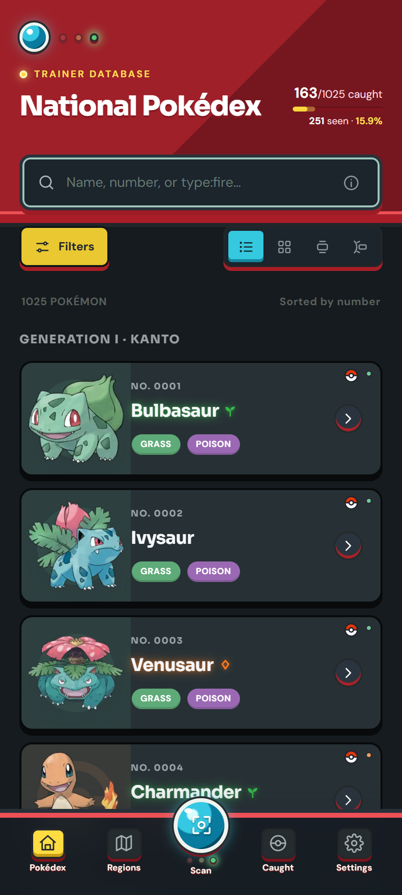 |

## Features

What's in the app today (version 0.4.1).

### Pokédex and profiles
- All 1,025 Pokémon with their regional forms, Megas and Gigantamax, fully offline.
- Profiles with an overview (Pokédex entries from every game, height, weight, abilities), base
  stats, moves by game, and type matchups.
- A stats calculator: level, IVs, EVs and nature give you the real numbers.
- Evolution chains drawn by their shape: straight lines, branches and Eevee-style hubs.
- Cries, a shiny toggle, and flares by the names of Legendary, Mythical and other special Pokémon.
- A game picker wheel with box art, to see an entry the way a given game shows it.
- Swipe left and right to move between entries in the order of the list you came from.
- National and regional dexes, with generation headers as you scroll.

### Dexes
- **Itemdex**, **Poké Balls**, **Key Items**, **Berrydex** and **TMs & HMs**.
- **Regions**, each with its regional dexes and every generation it appears in.
- **Trainerdex**: Gym Leaders, Elite Four, Champions and rivals, with their teams (moves, items,
  abilities) game by game.
- **Badges**: every badge by game; tap one to see its Gym Leader and their team.

### Search
- Search by name or number, or use the search language: `type:fire|dragon gen:1`,
  shown as removable chips.
- **"Who's that Pokémon?"**: pick what you remember (type, color, size, shape…) and it finds it.
- Tap a fact on a profile or dex page (an ability, a type, an egg group) to search for everything
  that shares it.
- Filters and sorting in every dex.

### Layouts
- Four layouts in every dex: **List**, **Grid**, **Carousel** and **Disc** (a wheel with an info
  panel, in landscape).
- Fast scroll with a bubble that shows where you are, and back to top.

### Your progress
- Mark Pokémon as seen, caught and shiny, per form, with seen and caught counts in the header.
- A caught tracker for your living dex.
- An "only discovered" mode that keeps Pokémon you haven't seen as silhouettes.
- Favorites and Recents.
- A trainer card that ranks up from Blue to Gold as you catch more.
- Backup and restore everything to a file.

### Tools
- **Type trainer**: a quiz on type matchups that asks the ones you miss more often.
- **Scanner** (preview): opens the camera with Rotom's intro. Real Pokémon recognition is on the
  way; for now it shows example results.

### Make it yours
- Themes: Modern, Classic, Diamond and Pearl, each in light and dark (or following your phone).
- A bottom bar with five slots: pick which section each one opens.
- Sound effects for taps, scrolling and searching, with a volume slider.
- Updates are offered inside the app when a new version comes out.

## Coming next

The plan, roughly in order. These are plans, not promises.

- **Bigger tools:** badge case, a "can learn this move" filter, a Gamedex, a catch-rate calculator,
  a team builder, region maps, and a Nuzlocke tracker.
- **Import from your saves:** read your caught Pokémon from game saves (Generations 1 to 5 first,
  later 3DS and Switch).
- **Gardens and crafting:** a berry garden, an Apricorn garden and a Poké Ball builder.
- **Gifts to real games:** send Mystery Gifts into a save file, and later to a 3DS or DS.
- **A real scanner:** point the camera at a Pokémon and have it recognized.
- **Shiny forms** throughout the app.
- **More themes:** Platinum, Red and Green, HeartGold and SoulSilver.
- **iPhone:** the app as a web app, served from a home server, and a smaller Android download that
  gets its data from there.
- **Later:** comparing two Pokémon, a Pokémon of the day, names in other languages, and links
  between dexes (an evolution item opens its Itemdex page).

## Install

**Android**

1. Download the latest `.apk` from [Releases](https://github.com/XZcutable/pokedex/releases/latest).
2. Open it. The first time, Android asks you to allow installing apps from your browser or file
   manager.
3. That's it. When a new version comes out, the app offers it (or check in Settings → Updates).

**iPhone:** not available yet (see Coming next).

## What's new

Every release lists its changes on the [Releases](https://github.com/XZcutable/pokedex/releases)
page.

## Disclaimer

PokéDex+ is an unofficial fan project. It is not affiliated with, endorsed by, or connected to
Nintendo, Game Freak, Creatures Inc. or The Pokémon Company. Pokémon and all related names,
characters and artwork are trademarks and © of their respective owners.
